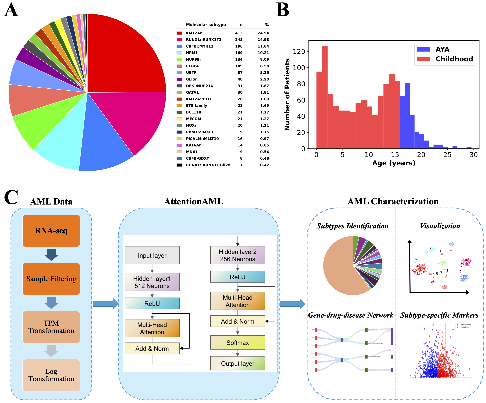

# AttentionAML: An <ins>Attention</ins>-based Deep Learning Framework for Accurate Molecular Categorization of <ins>A</ins>cute <ins>M</ins>yeloid <ins>L</ins>eukemia

**AttentionAML** (an **Attention**-Based Deep Learning Framework for Identifying **A**cute **M**yeloid **L**eukemia Subtypes), an accurate and effective model for AML subtype identification.

## Flowchart of AttentionAML


## Installation
1. Clone the AttentionAML git repository
```bash
git clone https://github.com/wan-mlab/AttentionAML.git
```

2. Use Python 3.11 in a dedicated environment:

```bash
python -m venv .venv
source .venv/bin/activate
python -m pip install -r requirements.txt
```

## Fixed 20% held-out test set

The repository includes the fixed manuscript test partition in [`benchmark/holdout20`](benchmark/holdout20/README.md). It contains 332 of the 1,656 included patients (20.05%), covers all 21 molecular subtypes, and was used consistently to evaluate RanAML, MLP, and AttentionAML. The partition is provided to support evaluation on exactly the same patients.

| File | Contents |
|---|---|
| `expression_log2TPM1.csv.gz` | Processed expression matrix containing 13,998 genes and 332 test samples; rows are genes, columns are samples, and values are log2(TPM+1) |
| `labels.csv` | Test sample IDs and true molecular-subtype labels |
| `sample_metadata.csv` | Test sample IDs, source datasets, and molecular subtypes |
| `split.csv` | Fixed train/test assignments for all 1,656 included patients |
| `subtype_counts.csv` | Number of held-out patients in each of the 21 subtypes |
| `provenance.json` | Source information and SHA-256 checksums |

### Download model weights

Download the AttentionAML and MLP weights from [Google Drive](https://drive.google.com/drive/folders/1cWJuXyUWNqF4H7h8VKygALG2mQpCUqh5?usp=drive_link). If compressed, extract the archives and place `AttentionAML.pt` and `MLP.pt` in `checkpoints/`. See [checkpoint instructions](checkpoints/README.md) for format requirements.

To evaluate a compatible AttentionAML checkpoint directly on the held-out expression matrix:

```bash
python -m attentionaml.predict \
  --checkpoint checkpoints/AttentionAML.pt \
  --expression benchmark/holdout20/expression_log2TPM1.csv.gz \
  --output results/AttentionAML_holdout_predictions.csv
```

The checkpoint must use the same preprocessing, gene identifiers and gene order, and output-class order. To reproduce model training with the original full expression matrix and labels while preserving this test partition, use:

```bash
python AML_holdout.py \
  --expression data/expression.csv \
  --labels data/labels.csv \
  --split-file benchmark/holdout20/split.csv \
  --models RanAML MLP AttentionAML \
  --device cuda \
  --output results/holdout20
```

The complete training expression matrix is not distributed in `benchmark/holdout20` due to patient privacy and data-sharing restrictions. Access can be requested through the data availability link in the article, and the data can be downloaded once the request is approved.

## Train and evaluate on a shared 20% holdout

```bash
python AML_holdout.py \
  --expression data/expression.csv --labels data/labels.csv \
  --models RanAML MLP AttentionAML \
  --device cuda --output results/holdout20
```

Use `--device cpu` without a GPU. Add `--models MLP` to run only the baseline. Defaults are fixed in `configs/`; use `--config-dir` for another configuration directory. All selected models use the same stratified 80/20 split. Reuse a previously reserved test partition with `--split-file`.

Outputs include test metrics, sample-level probabilities, training histories, split metadata, feature/class order, model checkpoints, probability distribution plots and row-normalized confusion matrices.

## Authors
Lusheng Li, Shibiao Wan

## Publication
AttentionAML: An Attention-based Deep Learning Framework for Accurate Molecular Categorization of Acute Myeloid Leukemia
Lusheng Li, Joseph D. Khoury, Jieqiong Wang, Shibiao Wan
bioRxiv 2025.05.20.655179v1; doi: https://doi.org/10.1101/2025.05.20.655179

## License 

[](https://www.gnu.org/licenses/gpl-3.0)

GNU GENERAL PUBLIC LICENSE  
Version 3, 29 June 2007

This program is free software: you can redistribute it and/or modify
it under the terms of the GNU General Public License as published by
the Free Software Foundation, either version 3 of the License, or
(at your option) any later version.

This program is distributed in the hope that it will be useful,
but WITHOUT ANY WARRANTY; without even the implied warranty of
MERCHANTABILITY or FITNESS FOR A PARTICULAR PURPOSE.  See the
GNU General Public License for more details.

You should have received a copy of the GNU General Public License
along with this program.  If not, see <https://www.gnu.org/licenses/>.
